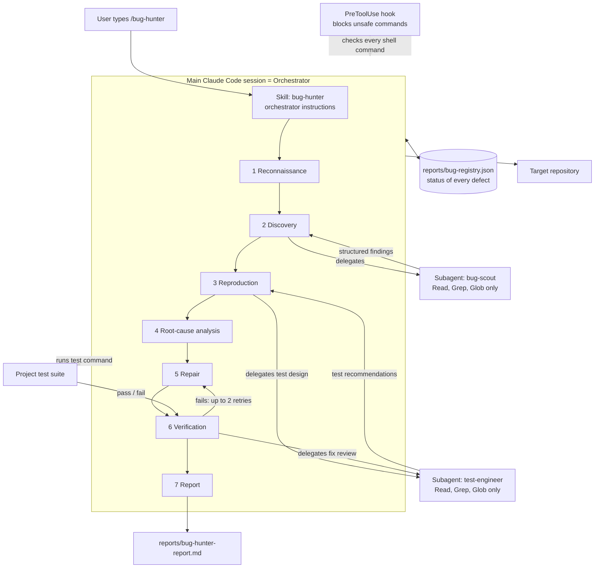

# Bug Hunter

By Addington Makosa, with help from Claude (Anthropic)

An autonomous debugging and repair skill for Claude Code. Type `/bug-hunter`
in a repository and Claude Code inspects the code, sends two specialist subagents
to investigate, reproduces each suspected defect, fixes the confirmed ones,
verifies the fixes with the test suite, and writes a report.

## Problem

Debugging by hand is a loop of reading code, guessing, reproducing, patching
and re-testing. The steps that make the result trustworthy are the ones most
often skipped: recording a baseline, reproducing a bug before changing code,
finding the cause instead of hiding the symptom, and checking for
regressions. An AI assistant given a one-line "fix the bugs" prompt can skip
them too, and its summary may not say which claims it actually checked.

## Objectives

1. Package a complete find, reproduce, fix and verify process as a reusable
   Claude Code skill, invoked with one command.
2. Split the work between an orchestrator and two read-only specialists with
   separate responsibilities.
3. Require evidence: nothing is called a bug until it is reproduced, and
   nothing is called fixed until the tests say so.
4. Stay safe in someone else's repository: preserve uncommitted work, make
   minimal changes, and never run destructive commands.
5. Measure the result against planted defects with tests the agent never
   sees, and report the numbers as they are.

## Architecture



Everything is built from native Claude Code parts: one skill, two subagents
and one hook. There is no server, database or framework. See
[docs/ARCHITECTURE.md](docs/ARCHITECTURE.md) for the reasoning.

## Agent responsibilities

| Agent | Defined in | Tools | Responsibility |
| ----- | ---------- | ----- | -------------- |
| **Orchestrator** | `.claude/skills/bug-hunter/SKILL.md` | All of the main session's tools, under Claude Code's normal permission prompts | Runs the seven phases, keeps the bug registry, decides what counts as confirmed, makes and verifies every change, writes the report. The only agent that edits files or runs commands. |
| **Bug Scout** | `.claude/agents/bug-scout.md` | `Read, Grep, Glob` | Reads the code against the specification and returns suspected defects: id, file, location, severity, evidence, expected against actual behaviour, a reproduction sketch, a recommended correction and a confidence level. |
| **Test Engineer** | `.claude/agents/test-engineer.md` | `Read, Grep, Glob` | Designs reproduction and regression tests, finds coverage gaps and edge cases, and reviews the finished diff to judge whether each fix removes the root cause. |

The specialists advise. They cannot change the repository, and they never
describe a suspicion as confirmed, because they have not run anything.

## Repository layout

```
bug-hunter/
├── .claude/
│   ├── skills/bug-hunter/
│   │   ├── SKILL.md                 the orchestrator workflow
│   │   ├── registry-template.json   shape of reports/bug-registry.json
│   │   └── report-template.md       the eleven report sections
│   ├── agents/
│   │   ├── bug-scout.md
│   │   └── test-engineer.md
│   ├── hooks/block-unsafe-commands.py
│   └── settings.json                wires the hook to shell commands
├── demo-app/                        deliberately broken transaction manager
│   ├── EXPECTED_BEHAVIOUR.md        its specification
│   └── tests/test_app.py            baseline tests (8 of 18 fail)
├── evaluation/
│   ├── make_sandbox.sh              fresh broken copy for a run
│   ├── check_discovery.sh           does Claude Code see the skill and agents?
│   ├── score_run.py                 scores a finished run
│   ├── hidden_tests/                held-out acceptance tests
│   ├── test_safety_hook.py          tests for the hook
│   ├── prompts/                     exact prompts used in the experiments
│   └── results/                     reports, registries and scores of each run
├── docs/                            ARCHITECTURE, WORKFLOW, EVALUATION
├── reports/                         where a run in this repository writes
├── pytest.ini                       running pytest here tests the hook
├── DEMO.md                          live demonstration script
└── DEVLOG.md                        development log
```

## Installation

Requirements: [Claude Code](https://code.claude.com/docs) 2.1 or later,
Git, and for the demo Python 3.9+ with pytest.

**Try it here.** Clone the repository and start Claude Code inside it. The
skill, subagents and hook under `.claude/` are picked up automatically.

```bash
git clone https://github.com/addingtonmakosa-eng/bug-hunter.git && cd bug-hunter
python3 -m pip install -r demo-app/requirements.txt   # pytest, for the demo
bash evaluation/check_discovery.sh                    # six "ok" lines expected
```

**Use it in another project.** Copy the `.claude` folder's contents into
that project:

```bash
cp -R .claude/skills .claude/agents .claude/hooks /path/to/project/.claude/
```

Then merge the `hooks` block from `.claude/settings.json` into that
project's `.claude/settings.json`. The hook is optional; the skill and
subagents work without it.

**Use it in every project.** Copy the skill and agents to your user
directory:

```bash
mkdir -p ~/.claude/skills ~/.claude/agents
cp -R .claude/skills/bug-hunter ~/.claude/skills/
cp .claude/agents/bug-scout.md .claude/agents/test-engineer.md ~/.claude/agents/
```

Restart Claude Code after adding agent files to a directory that did not
exist when the session started.

## Usage

Start `claude` in the repository you want examined, then:

| Command | Effect |
| ------- | ------ |
| `/bug-hunter` | Hunt across the whole repository. |
| `/bug-hunter demo-app` | Restrict the hunt, and all edits, to one directory. |
| `/bug-hunter src/billing rounding errors only` | A directory plus focus notes. |

Claude Code asks for permission before editing files and running commands, as it
always does. Bug Hunter leaves its changes uncommitted so that you can
review the diff. It writes:

| File | Contents |
| ---- | -------- |
| `reports/bug-hunter-report.md` | The report: eleven sections from Executive Summary to Final Assessment. |
| `reports/bug-registry.json` | Every defect with its status, evidence, root cause, fix and verification. |
| `reports/baseline-test-output.txt`, `reports/reproduction-test-output.txt`, `reports/final-test-output.txt` | Raw test output before any change, with the reproduction tests added, and after the fixes. |
| `reports/verification-log.txt`, `reports/changes.diff` | The test results after each fix, and the final diff. |

### Example

```
> /bug-hunter demo-app

[Bug Hunter] Phase 1/7 Reconnaissance complete
  Discovered 0 | Reproduced 0 | Confirmed 0 | Fixed 0 | Verified 0 | Unresolved 0
[Bug Hunter] Phase 2/7 Discovery complete
  Discovered 7 | Reproduced 0 | Confirmed 0 | Fixed 0 | Verified 0 | Unresolved 0
...
[Bug Hunter] Phase 7/7 Reporting complete
  Discovered 7 | Reproduced 7 | Confirmed 7 | Fixed 7 | Verified 7 | Unresolved 0
```

The numbers above illustrate the format. Real runs are recorded in
`evaluation/results/`.

## Workflow

| # | Phase | What happens |
| - | ----- | ------------ |
| 1 | Reconnaissance | Read-only survey: repository root, `git status`, languages, entry points, test command, where expected behaviour is documented. |
| 2 | Discovery | Bug Scout investigates. The orchestrator opens every cited location, merges duplicates and assigns severity. Speculation is set aside as observations. |
| 3 | Reproduction | The unchanged test suite is run and saved as the baseline. Test Engineer designs reproductions. A defect is *Confirmed* only when a reproduction fails as predicted and the expected result has a cited source. |
| 4 | Root-cause analysis | Why the code is wrong, with root causes separated from symptoms, secondary failures and missing coverage. |
| 5 | Repair | One defect at a time, highest severity first, with the smallest change that removes the cause. |
| 6 | Verification | Reproduction test, related tests and full suite after every fix. A failed fix gets at most two retries. Then a final full run, the project's linter if it has one, a diff review, and a fix review by Test Engineer. |
| 7 | Reporting | The report is written from the registry and the saved test output. |

Defect statuses: Discovered, Under investigation, Reproduced, Confirmed, Fix
proposed, Fix implemented, Verification passed, Verification failed,
Unresolved. Details and a state diagram are in
[docs/WORKFLOW.md](docs/WORKFLOW.md).

### Safety

- Git status is recorded first, and uncommitted work is never discarded.
- Application code is not changed before the baseline is recorded.
- Edits are limited to confirmed defects, tests and `reports/`.
- Installing dependencies, migrations, infrastructure changes and external
  calls need your approval.
- The specialists have read-only tools.
- A `PreToolUse` hook blocks a fixed list of destructive commands
  (`rm -rf`, `git reset --hard`, `git clean`, force pushes, `sudo`,
  `pip install`, printing `.env` files and others) before they run.
- Nothing bypasses Claude Code's permission prompts.

## Demonstration

`demo-app/` is a small transaction manager with planted defects and a
separate specification, `demo-app/EXPECTED_BEHAVIOUR.md`.

```bash
bash evaluation/make_sandbox.sh ~/bug-hunter-demo   # fresh broken copy
cd ~/bug-hunter-demo && claude                      # then type /bug-hunter
python3 /path/to/bug-hunter/evaluation/score_run.py ~/bug-hunter-demo
```

The full presentation sequence, with talking points, is in
[DEMO.md](DEMO.md).

## Evaluation

The benchmark is the five planted defects, plus one that no baseline test
exposes. A run is scored by `evaluation/score_run.py`, which uses 45
held-out tests that are never copied into the sandbox, checks which files
changed, and checks the report's sections. Detection and root-cause accuracy
are judged by reading the report against the answer key.

Results from 16 November 2026 (one or two trials per condition):

| | Without the skill (2 runs) | With the skill (3 runs) |
| - | -------------------------- | ----------------------- |
| Planted defects repaired | 5/5, 5/5 | 5/5, 5/5, 5/5 |
| Held-out regression tests passing | 10/10, 10/10 | 10/10 in all three |
| Unrelated files modified | 0, 1 | 0 in all three |
| Application lines changed | 67, 72 | 26, 38, 34 |
| Baseline saved and bug registry kept | no | yes |
| Report with all 11 sections | 0/11, 0/11 | 11/11, 11/11, and one run cut off before its report |

The skill did not raise the repair rate, which was already 5/5 on this
small benchmark. It changed how the work was done: smaller diffs, no edits
outside the defects, recorded evidence and a complete report. In the run
with delegated specialists, the independent fix review found a remaining
defect and an over-reaching fix that the orchestrator had missed.

These runs were made by an agent following `SKILL.md` in a cloud workspace,
not by typing `/bug-hunter` in an interactive session; Claude Code 2.1.326
was used there to confirm that the skill and agents load. A live run on
your own machine is still to be recorded.

Methodology, environment, full results, failed attempts and lessons are in
[docs/EVALUATION.md](docs/EVALUATION.md).

## Limitations

- **Not yet run live.** The workflow has been executed end to end by an
  agent following the skill file, and Claude Code loads the skill and both
  subagents, but `/bug-hunter` has not been typed in an interactive session.
- **Small benchmark.** One 120-line Python application with a written
  specification and a failing test for five of its six defects.
- **Needs a source of truth.** Where a project has no specification, tests
  or docstrings to define correct behaviour, Bug Hunter marks a suspicion
  as unresolved instead of guessing, so it will fix less.
- **Other languages are untested.** Language and test-command detection is
  written generally, but only Python with pytest has been run.
- **The hook is a deny-list.** It blocks known destructive commands and
  cannot catch every dangerous one. Claude Code's permission prompts remain
  the main control.
- **Cost and time.** A full run reads the code several times and starts up
  to three subagents. It is slower and uses more tokens than a single
  prompt, which matters on a small bug.
- **Model judgement.** Severity, root causes and "minimal" changes are
  judgements by the model. The report is evidence to review, not a
  guarantee.

## Future improvements

- Record a live `/bug-hunter` run from an interactive Claude Code session
  for each release of the skill, and add its score to the results table.
- More trials per condition, and a harder benchmark: a larger application,
  defects that interact, and defects with no failing test.
- Benchmarks in other languages (JavaScript with Jest, Go) to test the
  language detection.
- Mutation testing of the regression tests the agent writes, to measure
  whether they would catch the bug coming back.
- A `--report-only` mode that stops after Phase 4 and proposes fixes
  without making them.
- An allow-list version of the hook for stricter environments.
