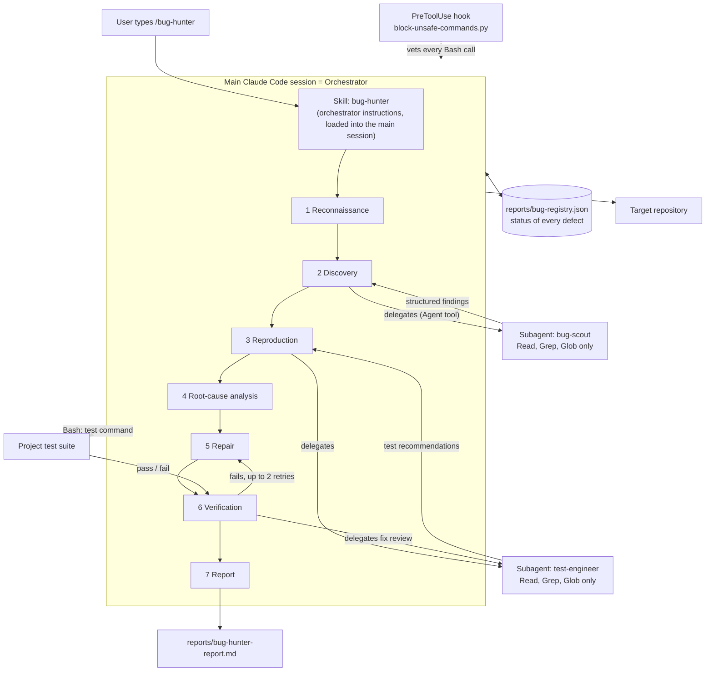

# Architecture

Bug Hunter is built only from native Claude Code parts: one skill, two
subagents and one hook. There is no server, database or framework.

## Components

| Component | File | Role |
| --- | --- | --- |
| Orchestrator skill | `.claude/skills/bug-hunter/SKILL.md` | The seven-phase workflow, safety rules, budgets and reporting rules. Typing `/bug-hunter` loads it into the main session, which then acts as the orchestrator. |
| Registry template | `.claude/skills/bug-hunter/registry-template.json` | Shape of `reports/bug-registry.json`. |
| Report template | `.claude/skills/bug-hunter/report-template.md` | The eleven report sections. |
| Bug Scout | `.claude/agents/bug-scout.md` | Read-only investigator. Returns potential defects as JSON with evidence, expected and actual behaviour, a reproduction sketch and a confidence level. |
| Test Engineer | `.claude/agents/test-engineer.md` | Read-only testing specialist with two modes: test design and fix review. |
| Safety hook | `.claude/hooks/block-unsafe-commands.py`, wired in `.claude/settings.json` | Deterministic deny-list checked before every Bash call. |

## Why it is split this way

**The orchestrator is a skill, not a subagent.** A skill's instructions load
into the main conversation, so the orchestrator keeps the user's context, can
ask the user for approval, and can call subagents. It is the only actor with
write access.

**The specialists are subagents.** Each runs in its own context window, so a
long read through the code base does not crowd the orchestrator's context,
and each starts without the orchestrator's assumptions. Their `tools` line
grants `Read, Grep, Glob` and nothing else, so they cannot edit files or run
commands even if their instructions were ignored.

**Responsibilities do not overlap.**

| | Reads code | Runs commands | Edits files | Decides what is a bug | Approves fixes |
| --- | --- | --- | --- | --- | --- |
| Orchestrator | yes | yes | yes | yes, after reproduction | yes |
| Bug Scout | yes | no | no | no, it reports suspicions | no |
| Test Engineer | yes | no | no | no, it designs tests and reviews | no, it advises |

**State lives in a file.** The registry records each defect's status and
history. The report is generated from it, which keeps the four counts
(discovered, confirmed, fixed, verified) consistent, and a person or a script
can inspect a run afterwards.

**Rules that must always hold are in a hook.** Instructions in a skill are
followed with judgement; a hook runs every time. The hook blocks a short list
of destructive, privilege-raising, dependency-changing and
credential-revealing commands. It is a backstop for the skill's rules and for
Claude Code's own permission prompts, not a replacement for either.

## Permissions

The skill's `allowed-tools` line pre-approves only reading (`Read`, `Grep`,
`Glob`) and read-only git commands (`git status`, `git diff`, `git log`,
`git rev-parse`, `git ls-files`). Editing files and running the test command
go through Claude Code's normal permission flow, so the user approves them or
has already allowed them in their own settings. Nothing in this project
bypasses permission checks.

## Portability

Nothing refers to an absolute path. The skill finds its own templates through
`${CLAUDE_SKILL_DIR}`, the hook finds itself through `$CLAUDE_PROJECT_DIR`,
and the workflow detects the language and test command from the repository's
own manifests. To use Bug Hunter in another repository, copy `.claude/` into
it, or copy the skill and agents to `~/.claude/` for every project (see the
README).
