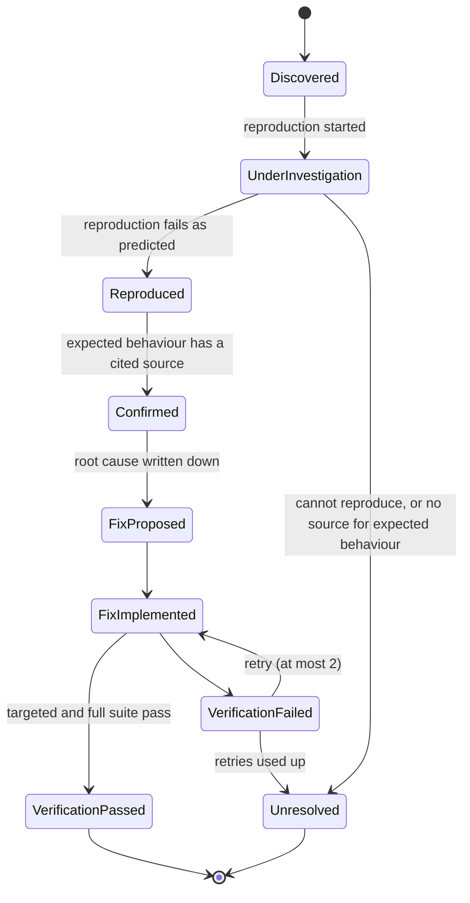

# Workflow

What happens after you type `/bug-hunter`. The authoritative version is
`.claude/skills/bug-hunter/SKILL.md`; this page explains it.

## Invocation

| Command | Effect |
| --- | --- |
| `/bug-hunter` | Hunt across the whole repository. |
| `/bug-hunter demo-app` | Restrict the hunt, and all edits, to one directory. |
| `/bug-hunter src/billing rounding errors only` | Directory plus focus notes. |

## The seven phases

| # | Phase | Who | What happens | Output |
| - | ----- | --- | ------------ | ------ |
| 1 | Reconnaissance | Orchestrator | Finds the repository root, records `git status`, detects languages, frameworks, entry points, the test command and where expected behaviour is documented. Read-only. | Initial `reports/bug-registry.json` |
| 2 | Discovery | Bug Scout, then orchestrator | The scout reads the code against the specification and returns potential defects. The orchestrator opens each cited location, merges duplicates, assigns ids and severity, and sets speculative items aside as observations. | Defects with status *Discovered* |
| 3 | Reproduction | Orchestrator, with Test Engineer | The unchanged test suite is run and saved as the baseline. The test engineer designs reproduction tests. Each defect gets a cited source of expected behaviour and a reproduction that is actually run. | *Reproduced*, *Confirmed* or *Unresolved*; `reports/baseline-test-output.txt` |
| 4 | Root-cause analysis | Orchestrator | Traces why the code is wrong and separates root causes from symptoms, secondary failures and missing test coverage. | `root_cause` per defect; *Fix proposed* |
| 5 | Repair | Orchestrator | One defect at a time, highest severity first, with the smallest change that removes the cause. | *Fix implemented* |
| 6 | Verification | Orchestrator, with Test Engineer | The defect's own reproduction tests (selected by id), related tests, then the full suite after every fix. Final full run, linter if the project has one, diff review, and a fix review by the test engineer. | *Verification passed* or *failed*; `reports/verification-log.txt`, `reports/final-test-output.txt`, `reports/changes.diff` |
| 7 | Reporting | Orchestrator | Writes the report from the registry and the saved outputs. | `reports/bug-hunter-report.md` |

## Defect statuses



The report keeps four counts apart:

- **Discovered**: entered in the registry.
- **Confirmed**: reproduced, with a cited source of expected behaviour.
- **Fixed**: a fix was implemented.
- **Verified**: the fix passed its reproduction test and the full suite.

## The verification feedback loop

```
fix -> reproduction test -> related tests -> full suite
        |                                      |
        +-- any failure: read it, decide whether the fix, the root cause
            or the test is wrong, correct, and verify again
            (initial attempt + 2 retries, then Unresolved)
```

A test is only changed when the specification can be cited against it. A
defect that is still failing after the retries is returned to a state no
worse than the baseline and reported as unresolved.

## Budgets

| Limit | Value |
| --- | --- |
| Repair attempts per defect | 1 initial + 2 retries |
| Defects repaired per run | 10, highest severity first |
| Bug Scout runs | 1 (a second only if a directory was clearly missed) |
| Test Engineer runs | 2 (design, review) |

## Safety rules

The skill's rules, in short: evidence before belief; baseline before edits;
never claim what was not observed; never discard the user's uncommitted
work; edit only what a confirmed defect needs; ask before installing
dependencies, touching infrastructure, running migrations or calling
external services; never print secrets; never work around a denied
permission. Changes are left uncommitted for the user to review.

The hook enforces part of this mechanically. Examples of what it blocks:

| Blocked | Reason |
| --- | --- |
| `rm -rf`, `rm -r` | Recursive or forced deletion |
| `git reset --hard`, `git clean`, `git checkout -- <path>`, `git restore <path>` | Discards uncommitted work |
| `git push --force`, `git branch -D`, `git stash drop` | Destroys history or saved work |
| `sudo ...`, `curl ... \| sh`, `chmod 777` | Privilege and remote-code risks |
| `pip install`, `npm install` | Dependency changes need approval |
| `alembic upgrade`, `manage.py migrate`, `DROP TABLE` | Database changes need approval |
| `printenv`, `cat .env` | Credential exposure |
| `terraform apply`, `kubectl apply` | Infrastructure changes |

`evaluation/test_safety_hook.py` checks 28 blocked and 20 allowed commands.

## When a specialist is unavailable

The skill's "Delegating to the specialists" section covers three cases, and
the registry records which one happened:

| Situation | What the orchestrator does | Recorded as |
| --- | --- | --- |
| The named subagent starts | Delegates to it. Claude Code enforces its `Read, Grep, Glob` tool limit. | `delegated` |
| The named type is not found, but a general subagent can be started | Starts one, gives it the file in `.claude/agents/` as its role, tells it to stay read-only, and checks `git status` afterwards. | `delegated with a fallback: <reason>` |
| No subagent can be started | Does the specialist's work itself by following the agent file, and says the review was not independent. | `performed inline: <reason>` |

It never describes a delegation that did not happen. If Claude Code reports
that `bug-scout` or `test-engineer` does not exist, restart it: an `agents`
directory created after a session started is not picked up until the next
session.

## Other languages

Phase 1 detects the stack from manifests (`package.json`, `go.mod`,
`Cargo.toml`, `pom.xml` and so on) and takes the test command from the
project's own configuration. The specialists' checklists are not tied to
Python. New regression tests follow the project's test naming convention.
Only the Python demo has been tested; see `docs/EVALUATION.md`.
